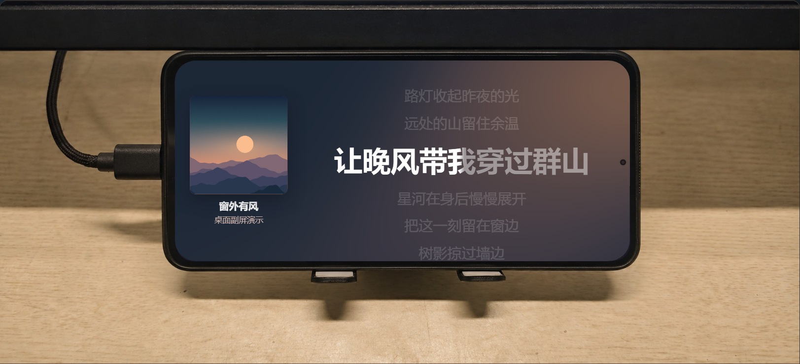
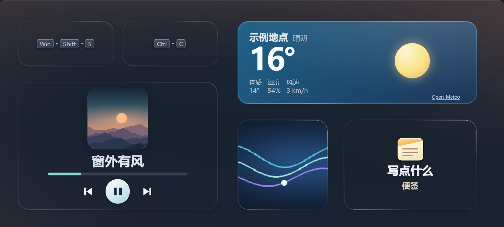
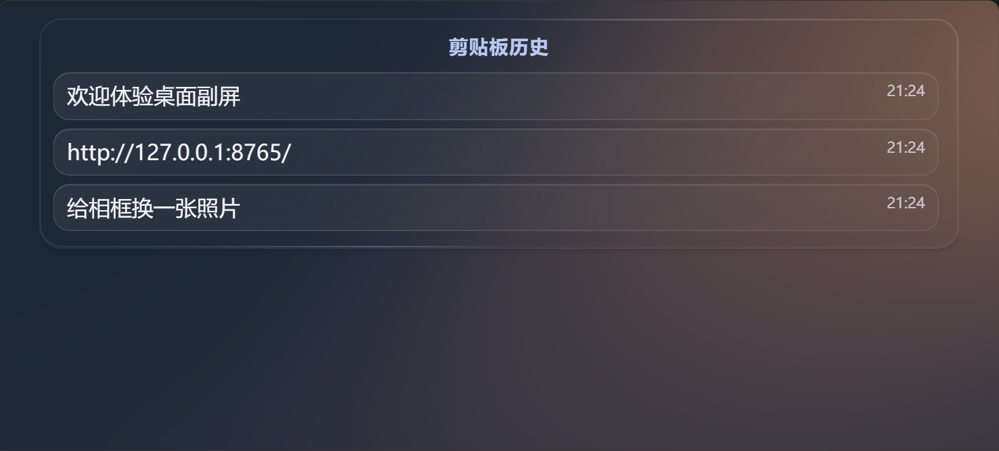
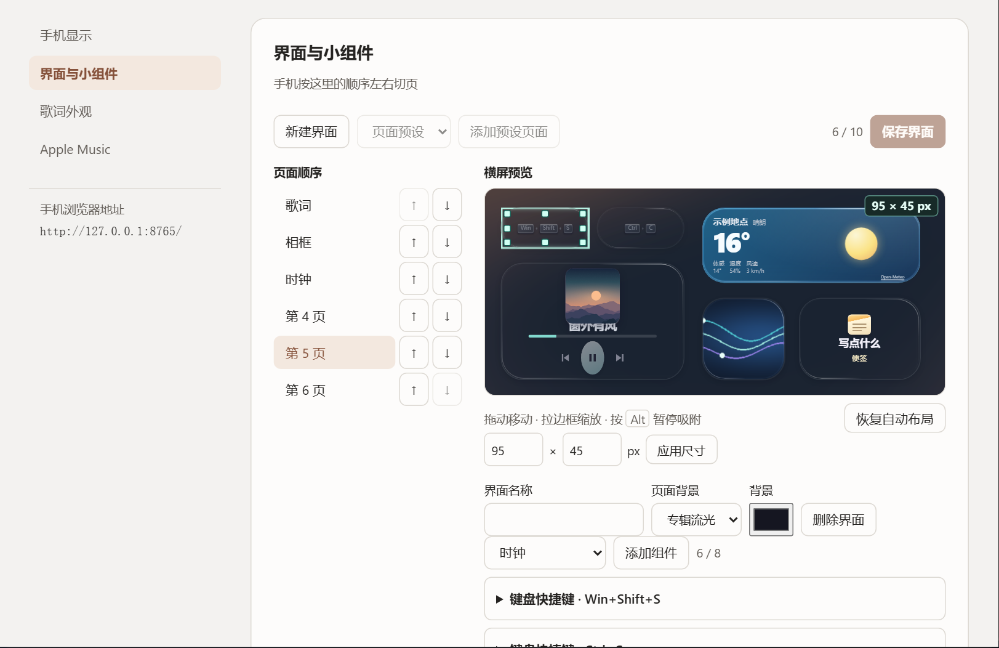
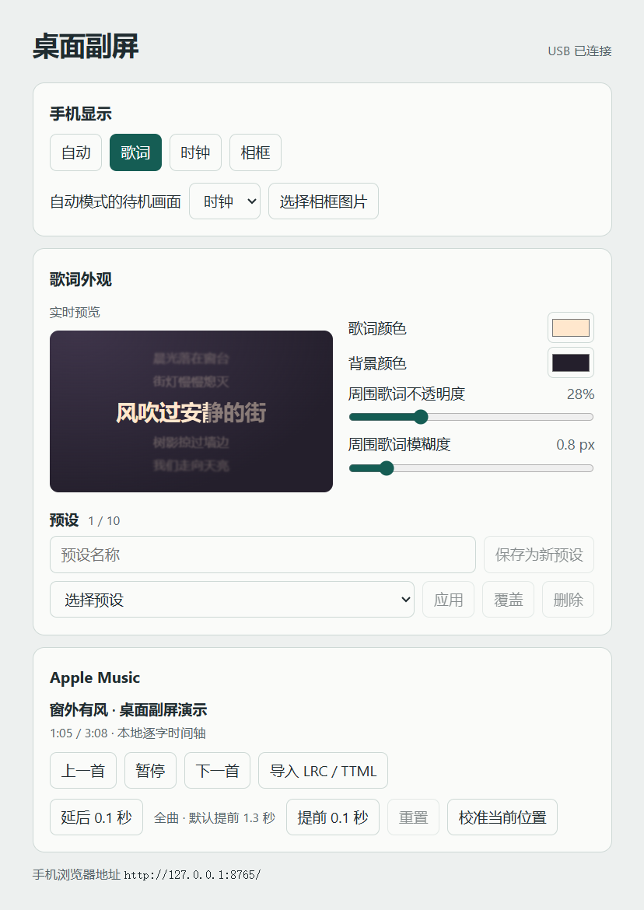

# 桌面副屏 · Desk Side Display

用 USB 把闲置的安卓手机变成横屏桌面摆件。Windows 上播放 Apple Music 或网易云音乐时，手机显示专辑封面和歌词。平时可以滑到时钟、相框、硬件监控，或自己排版的卡片页面。

[下载 Windows 版](https://github.com/kdwbll/desk-side-display/releases/latest) · [在线体验](https://kdwbll.github.io/desk-side-display/) · [使用说明](使用说明.md) · [参与贡献](CONTRIBUTING.md) · [MIT 许可证](LICENSE)

点击上图打开在线演示。可以左右切页、操作卡片，也能在网页控制面板调整歌词外观和组件布局。演示静音，Windows 动作在网页内模拟。桌面场景使用实拍照片，屏幕内为当前版本的演示画面。

## 手机上能看到什么

**逐字歌词与专辑流光**。背景从封面提取主色，让色块沿平滑的随机路径移动。高亮用柔和的灰白渐变扫过正在唱的字。每行提前 0.1 秒开始切换，逐字高亮继续跟随校准后的时间戳。上下文延伸到屏幕边缘，透明度和模糊度可调。

| 全屏时钟预设 | 全屏相框预设 |
| --- | --- |
|  |  |

时钟和相框可在控制面板按需添加。每个页面都可单独开启专辑流光。

**自定义卡片**。手机左右滑动切页，每页最多 8 张卡片，总计最多 10 页。可添加天气、音乐、快捷键、便签、时钟、图片和 GIF 等卡片。启用相应权限后，点击便签可在 Windows 桌面新建并打开 TXT，点击快捷键卡片可发送预设的按键。切回页面时，天气和剪贴板会直接显示上次的内容，再按各自的间隔刷新。

| 硬件监控 | 剪贴板历史 |
| --- | --- |
|  |  |

硬件监控可显示 Windows 的实时读数。剪贴板历史支持文本、图片和文件名，启用组件动作后可点选条目粘贴到 Windows。上图中的歌词、封面、照片、天气、硬件读数和剪贴板内容均为演示数据。

## Windows 控制面板

- **界面与小组件**把页面顺序和横屏预览放在同一区域。可直接拖动、缩放和吸附对齐卡片，或输入像素宽高，保存后同步到手机。
- **组件数据源与权限**用于设置天气地点，启用便签等组件动作，以及配置剪贴板历史、窗口信息和自定义数据源。也可使用 AI 生成可导入的 JSON 组件。 [小组件规范](docs/widget-api.md)
- **歌词外观**支持实时预览歌词颜色、上下文不透明度、模糊度、流光速度和色块过渡，最多保存 10 组预设。
- **音乐播放**可在 Apple Music 和网易云音乐之间选择。只有一款在播放时可自动跟随，两款都在播放时提示选源。手机歌词、封面和播放按钮都跟随所选来源。
- **歌词进度**优先使用播放器上报的时间轴。网易云只提供曲目信息时，可按匹配到的总时长估算进度。需要网易云实时时间轴时，可使用 BetterNCM + InfLink-rs。 [播放源与歌词说明](使用说明.md#播放源与歌词)

## 快速开始

1. 解压 [GitHub Releases](https://github.com/kdwbll/desk-side-display/releases/latest) 中的 `win-x64.zip` 发布包。发布包内置 .NET 运行时。从源码启动时需安装 [.NET 9 SDK](https://dotnet.microsoft.com/download/dotnet/9.0)。
2. 从 Android 官网下载 Windows 版 [SDK Platform-Tools](https://developer.android.com/tools/releases/platform-tools)，将解压后的 `platform-tools` 文件夹放在程序目录的 `.tools` 文件夹内，确认路径为 `.tools\platform-tools\adb.exe`。需要歌词时，在电脑安装 Apple Music 或网易云音乐桌面客户端。
3. 双击 [Create-Desktop-Shortcut.cmd](Create-Desktop-Shortcut.cmd)，在 Windows 桌面创建「桌面副屏」。以后双击这个图标就能打开控制面板。也可以直接运行 [Start-DeskSideDisplay.cmd](Start-DeskSideDisplay.cmd)。
4. 在安卓手机上开启 USB 调试，通过支持数据传输的 USB 线连上电脑，并在手机上允许调试。
5. 控制面板显示「USB 已连接」后，用**手机浏览器**访问 `http://127.0.0.1:8765/`。把手机横放，轻点页面进入全屏。可在 Windows 播歌查看歌词，也可在「界面与小组件」添加卡片及全屏预设。

首次配置、歌词匹配和排查步骤见[详细使用说明](使用说明.md)。

## 项目结构

| 路径 | 用途 |
| --- | --- |
| `DeskSideDisplay.csproj` | .NET 9 项目和构建配置 |
| `Program.cs` | Windows 服务入口、页面路由和本机接口 |
| `Services/Media/` | 读取 Windows 播放会话，在 Apple Music 和网易云音乐之间选源并控制播放 |
| `Services/Lyrics/` | 歌词匹配、时间轴解析、导入和校准 |
| `Services/Display/` | 硬件指标、剪贴板历史、快捷键与便签动作 |
| `Services/Settings/` | 界面布局、相框、卡片媒体、外观和预设的保存 |
| `Services/Usb/` | Android 设备识别与 USB 端口转发 |
| `wwwroot/control/` | Windows 控制面板 |
| `wwwroot/display/` | Android 横屏显示页 |
| `wwwroot/shared/` | 两个页面共用的组件、布局和歌词样式 |
| `docs/screenshots/` | 手机实拍与控制面板的演示截图 |
| `demo/` | GitHub Pages 在线体验和静态构建脚本 |

本机设置、相框、卡片媒体和歌词保存在 `.data/`，ADB 工具放在 `.tools/`。这些目录由 Git 忽略。

## 许可与贡献

项目采用 [MIT 许可证](LICENSE)。欢迎 Fork、修改并提交 Pull Request。第三方依赖的版权声明、许可证以及参考项目列在[第三方声明](THIRD-PARTY-NOTICES.md)中。贡献流程见[参与贡献](CONTRIBUTING.md)。
