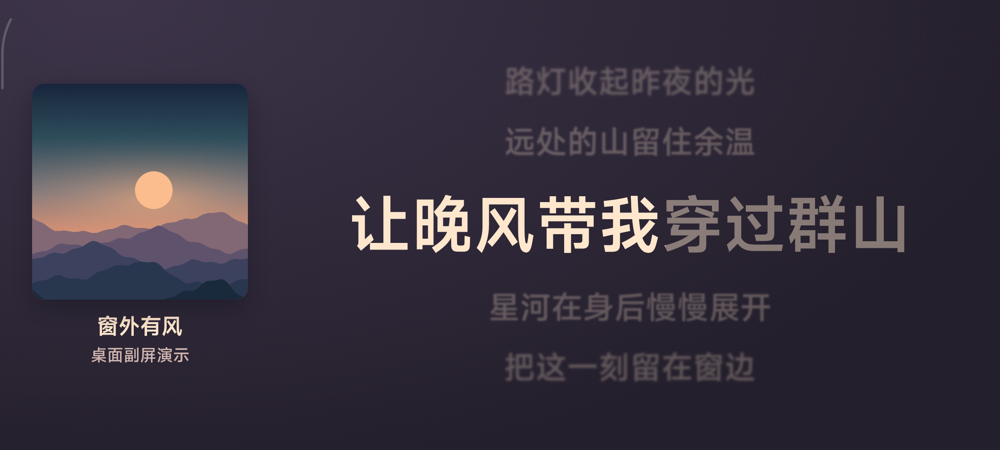
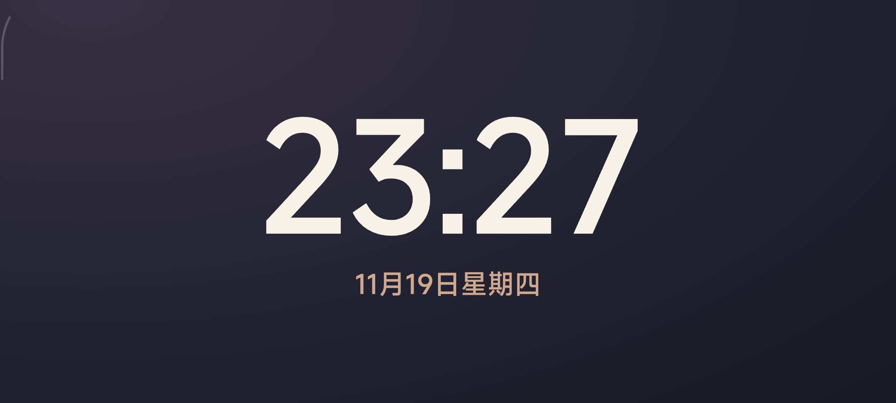
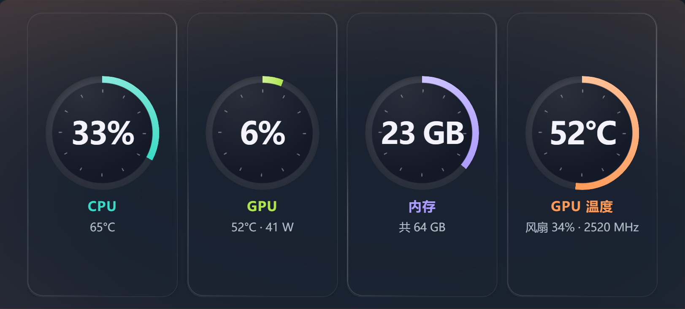

# 桌面副屏 · Desk Side Display

用 USB 把闲置的安卓手机变成横屏桌面摆件。Windows 上播放 Apple Music 时，手机显示专辑封面和同步歌词。平时可以滑到时钟、相框、硬件监控，或自己排版的卡片页面。

[使用说明](使用说明.md) · [参与贡献](CONTRIBUTING.md) · [MIT 许可证](LICENSE)

桌面布置实拍，手机屏幕替换为项目的演示画面。

## 手机上能看到什么

**歌词模式**。曲名和歌手位于封面下方。当前歌词在右侧区域居中，前后各两句带透明度与模糊效果，切行时平滑过渡。有逐字时间戳的歌曲会按字高亮，其余匹配到同步时间轴的歌曲会按句高亮。

| 全屏时钟预设 | 全屏相框预设 |
| --- | --- |
|  |  |

以上画面截自通过 USB 连接的安卓手机。歌词、封面和照片使用演示内容。两种全屏预设可在控制面板按需添加。

手机左右滑动切换页面。一页最多放 8 张卡片，总计最多 10 页。图中的便签可轻点，在 Windows 桌面生成一个 TXT 并用记事本打开。卡片示例使用演示配置。

硬件监控页可显示 Windows 实时采样的 CPU、GPU、内存和温度。

## Windows 控制面板

- **界面与小组件**用于排序页面、添加预设和挑选组件。拖动卡片会吸附到附近卡片的边缘或中心。拉伸可匹配等宽等高，选中卡片后也可输入像素宽高。
- **组件数据源与权限**用于设置天气地点，启用便签等组件动作，以及配置剪贴板历史、窗口信息和自定义数据源。也可使用 AI 生成可导入的 JSON 组件。 [小组件规范](docs/widget-api.md)
- **歌词外观**支持实时预览颜色、背景、不透明度和模糊度，最多保存 10 组预设。
- **Apple Music**支持切歌、暂停、导入 LRC 或 TTML，以及校准全曲或指定时段的歌词。默认提前 1.3 秒。

## 快速开始

1. 在 Windows 安装 [.NET 9 SDK](https://dotnet.microsoft.com/download/dotnet/9.0) 和 Apple Music 桌面客户端。下载 Windows 版 [Android SDK Platform-Tools](https://developer.android.com/tools/releases/platform-tools)，将解压后的 `platform-tools` 文件夹放在项目的 `.tools` 目录内。
2. 双击 [Start-DeskSideDisplay.cmd](Start-DeskSideDisplay.cmd)，打开 Windows 控制面板。
3. 在安卓手机上开启 USB 调试，通过支持数据传输的 USB 线连上电脑，并在手机上允许调试。
4. 控制面板显示「USB 已连接」后，用**手机浏览器**访问 `http://127.0.0.1:8765/`。把手机横放，轻点页面进入全屏。随后可播放 Apple Music 看歌词，或在控制面板的「界面与小组件」添加卡片及全屏预设。

首次配置、歌词匹配和排查步骤见[详细使用说明](使用说明.md)。

## 项目结构

| 路径 | 用途 |
| --- | --- |
| `DeskSideDisplay.csproj` | .NET 9 项目和构建配置 |
| `Program.cs` | Windows 服务入口、页面路由和本机接口 |
| `Services/Media/` | 读取和控制 Windows 上的 Apple Music |
| `Services/Lyrics/` | 歌词匹配、时间轴解析、导入和校准 |
| `Services/Display/` | 硬件指标、剪贴板历史、快捷键与便签动作 |
| `Services/Settings/` | 界面布局、相框、卡片媒体、外观和预设的保存 |
| `Services/Usb/` | Android 设备识别与 USB 端口转发 |
| `wwwroot/control/` | Windows 控制面板 |
| `wwwroot/display/` | Android 横屏显示页 |
| `wwwroot/shared/` | 两个页面共用的组件、布局和歌词样式 |
| `docs/screenshots/` | 手机实拍与控制面板的演示截图 |

本机设置、相框、卡片媒体和歌词保存在 `.data/`，ADB 工具放在 `.tools/`。这些目录由 Git 忽略。

## 许可与贡献

项目采用 [MIT 许可证](LICENSE)。欢迎 Fork、修改并提交 Pull Request。第三方依赖的版权声明、许可证以及参考项目列在[第三方声明](THIRD-PARTY-NOTICES.md)中。贡献流程见[参与贡献](CONTRIBUTING.md)。
