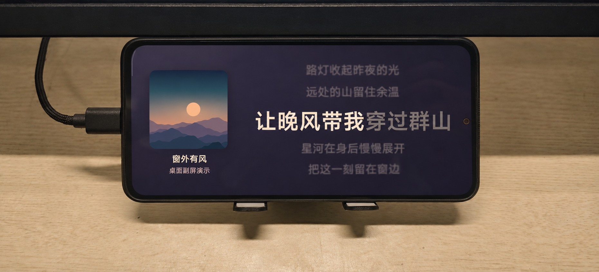

# 桌面副屏 · Desk Side Display

用 USB 把闲置的安卓手机变成横屏桌面摆件。Windows 上播放 Apple Music 时，手机显示封面和同步歌词。平时可以用作时钟或数码相框。

[使用说明](使用说明.md) · [参与贡献](CONTRIBUTING.md) · [MIT 许可证](LICENSE)

桌面布置实拍，手机屏幕替换为项目的演示画面。

## 手机截图

**歌词模式**。曲名和歌手位于封面下方。当前歌词在右侧区域居中，前后各两句带透明度与模糊效果，切行时平滑过渡。有逐字时间戳的歌曲会按字高亮，其余匹配到同步时间轴的歌曲会按句高亮。

| 时钟 | 相框 |
| --- | --- |
|  |  |

截图来自通过 USB 连接的安卓手机。歌词、封面和相框图片使用原创演示内容。

硬件监控页使用 Windows 实时采样的数据。手机可横滑到硬件监控和自定义组件界面。

## Windows 控制面板

- **手机显示**可以切换歌词、时钟和相框。「自动」会随音乐播放切换。
- **界面与小组件**可调整手机横滑顺序，按需添加全屏时钟、全屏相框和自定义界面。图片、Emoji、时钟和 GIF 都可以作为卡片添加，并在预览中输入像素宽高。v2 自定义组件可绑定剪贴板、窗口、网络、电量和用户注册的数据源。 [小组件规范](docs/widget-api.md)
- **歌词外观**可以调文字颜色、背景颜色、周围歌词不透明度和模糊度。修改时可实时预览，最多保存 10 组预设。
- **Apple Music**可以切歌、暂停、导入 LRC 或 TTML，以及校准全曲或某一段的歌词。歌词默认提前 1.3 秒。

## 快速开始

1. 在 Windows 安装 [.NET 9 SDK](https://dotnet.microsoft.com/download/dotnet/9.0) 和 Apple Music 桌面客户端。下载 Windows 版 [Android SDK Platform-Tools](https://developer.android.com/tools/releases/platform-tools)，将解压后的 `platform-tools` 文件夹放在项目的 `.tools` 目录内。
2. 双击 [Start-DeskSideDisplay.cmd](Start-DeskSideDisplay.cmd)，打开 Windows 控制面板。
3. 在安卓手机上开启 USB 调试，通过支持数据传输的 USB 线连上电脑，并在手机上允许调试。
4. 控制面板显示「USB 已连接」后，用**手机浏览器**访问 `http://127.0.0.1:8765/`。把手机横放，轻点页面进入全屏。在 Windows 上开始播放 Apple Music，或在控制面板选择时钟、相框。

首次配置、歌词匹配和排查步骤见[详细使用说明](使用说明.md)。

## 项目结构

| 路径 | 用途 |
| --- | --- |
| `DeskSideDisplay.csproj` | .NET 9 项目和构建配置 |
| `Program.cs` | Windows 服务入口、页面路由和本机接口 |
| `Services/Media/` | 读取和控制 Windows 上的 Apple Music |
| `Services/Lyrics/` | 歌词匹配、时间轴解析、导入和校准 |
| `Services/Settings/` | 显示模式、相框、外观和预设的保存 |
| `Services/Usb/` | Android 设备识别与 USB 端口转发 |
| `wwwroot/control/` | Windows 控制面板 |
| `wwwroot/display/` | Android 横屏显示页 |
| `wwwroot/shared/` | 两个页面共用的歌词外观逻辑与样式 |
| `docs/screenshots/` | 手机实拍与控制面板的演示截图 |

本机设置、相框和歌词数据保存在 `.data/`，ADB 工具放在 `.tools/`。这些目录由 Git 忽略。

## 许可与贡献

项目采用 [MIT 许可证](LICENSE)。欢迎 Fork、修改并提交 Pull Request。第三方依赖的版权声明、许可证以及参考项目列在[第三方声明](THIRD-PARTY-NOTICES.md)中。贡献流程见[参与贡献](CONTRIBUTING.md)。
