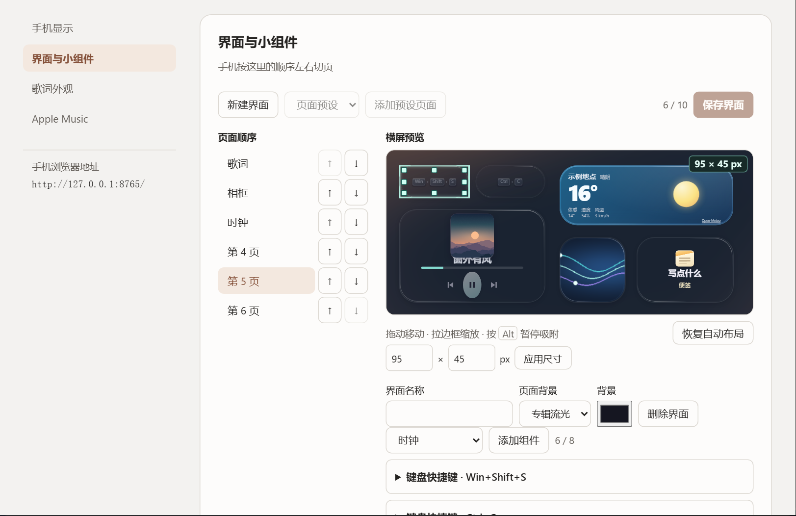
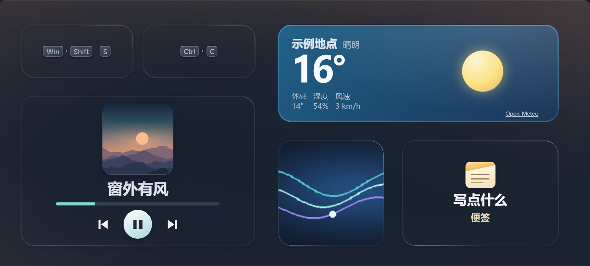
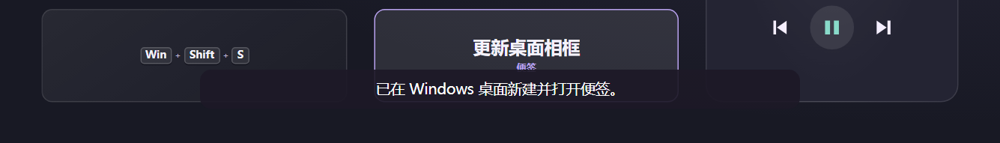
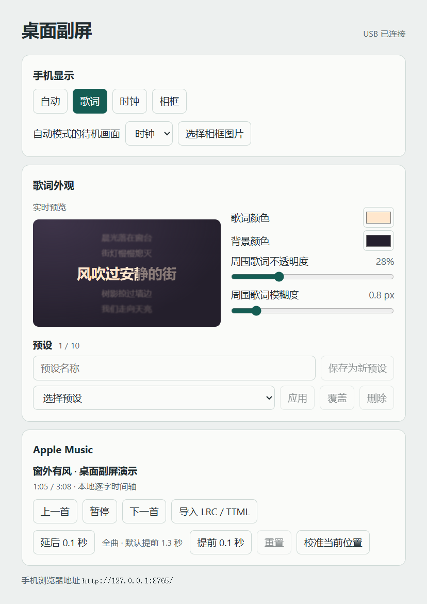

# 桌面副屏使用说明

## 启动和连接

1. 在 Windows 上双击项目目录中的 [Create-Desktop-Shortcut.cmd](Create-Desktop-Shortcut.cmd)，把「桌面副屏」添加到桌面。这一步只做一次。以后双击桌面图标即可启动服务并打开控制面板，命令窗口会最小化。也可以在项目目录直接双击 [Start-DeskSideDisplay.cmd](Start-DeskSideDisplay.cmd)。
2. 用支持数据传输的 USB 线连接安卓手机。首次使用先开启手机的「USB 调试」，再解锁并在授权弹窗点「允许」。如果需要开启开发者选项，在「设置 → 关于手机」连续点按版本号七次，再到开发者选项开启 USB 调试。菜单名称随手机型号而异。 [Android 官方 ADB 文档](https://developer.android.com/tools/adb)
3. 控制面板显示「USB 已连接」后，在**手机浏览器**打开 `http://127.0.0.1:8765/`。开启手机自动旋转，把手机横放，轻点画面即可请求全屏。
4. 在 **Windows 的 Apple Music 桌面客户端**播放一首歌。控制面板显示曲名和进度后，手机就能按播放器进度显示歌词。

插手机、启动副屏和播放音乐的顺序随意。服务已经运行时，再次双击桌面图标会打开[控制面板](http://127.0.0.1:8766/)。退出时，可以打开最小化的启动窗口并按 `Ctrl+C`。后台运行时，可在任务管理器的「详细信息」里通过命令行确认本项目的 `DeskSideDisplay.dll`，然后结束对应的 `dotnet.exe` 进程。修改代码后，先退出旧服务，再双击桌面图标重新构建。移动项目目录后，删除旧快捷方式并重新运行创建脚本。

## 显示模式

| 模式 | 手机画面 |
| --- | --- |
| 自动 | 播放时显示歌词。暂停后歌词保留约 15 秒，再回到指定的待机画面。 |
| 歌词 | 固定显示播放器信息和歌词。 |
| 时钟 | 固定显示时间和日期。 |
| 相框 | 固定显示所选图片。 |

自动模式的待机画面可选硬件监控，或已经添加的全屏时钟、全屏相框。添加全屏相框并保存后，在「手机显示」里点「选择相框图片」，可导入 **8 MB 以内**的 JPG、PNG、WebP 或 GIF。选图后会切到相框。需要随播放自动切换时，再点「自动」。

## 手机切页和全屏预设

手机左右滑动会按已保存的顺序循环切页。切回页面时直接显示上次读取的组件内容，数据按各组件的刷新间隔更新。

1. 在 Windows 控制面板打开「界面与小组件」。点「新建界面」可以从空白页开始。
2. 要添加全屏时钟或相框，从「页面预设」选一项，再点「添加预设页面」。两种预设都可单独移除。歌词和硬件监控是内置页面。
3. 用「页面顺序」里的上下箭头调整顺序，检查右侧横屏预览后点顶部的「保存界面」。最多可保存 **10 页**，每页最多 **8 张卡片**。

时钟、相框、硬件监控和自定义页都可以单独选择「页面背景 → 专辑流光」，预览满意后点「保存界面」。有封面时使用封面主色，空闲时用页面底色生成流光。相框图片完整显示，四周露出流光。流速和色块过渡共用「歌词外观」里的两个滑块。

## 添加卡片和调整布局

图中选中了一个快捷键卡片。预览右上角显示实时尺寸，下方可分别输入宽和高。

1. 在目标页面的「组件类型」中选择一项，点「添加组件」。展开对应卡片的设置即可修改内容、颜色和名称。页面名或组件名留空时，手机上会隐藏对应标题。
2. 拖卡片移动，拉边或角调整尺寸。靠近其他卡片的边缘或中心时会吸附，拉伸也能吸附到另一张卡片的宽度或高度。按住 `Alt` 可暂时关闭吸附，卡片边界仍会防止重叠。
3. 要输入尺寸，先选中卡片，在预览下方填宽、高，再按 Enter 或点「应用尺寸」。数字表示当前 Windows 预览中的像素，手机按页面比例呈现。也可用方向键移动，按住 `Shift` 再按方向键调整尺寸。
4. 点「保存界面」同步到手机。需要重新排版时可点「恢复自动布局」。

| 卡片 | 设置方法 |
| --- | --- |
| 图片、GIF | 每张卡片独立选文件，最大 **8 MB**。静态图片支持 JPG、PNG、WebP，动图用 GIF。「完整显示」保留整张图，「铺满卡片」填满卡片区域。 |
| Emoji、时钟 | 用 `Win + .` 在 Windows 输入 Emoji。时钟卡片显示本地时间和日期，可以与其他卡片放在同一页。 |
| 天气 | 从可复用组件中添加「天气」，在「组件数据源与权限」填地点经纬度。支持卡片、圆形、胶囊和方形。 |
| 正在播放 | 显示专辑封面、歌名和只读进度条。启用组件动作后，可从手机切歌或播放、暂停。 |
| 硬件仪表 | 可选 CPU、GPU、内存及温度等指标。硬件监控页自带四张仪表卡。 |

硬件读数取决于设备和驱动。CPU 占用和内存由 Windows 提供，NVIDIA 显卡可用驱动自带的 `nvidia-smi`。部分温度等指标可由正在运行的 LibreHardwareMonitor 提供，缺少读数时显示 `—`。 [LibreHardwareMonitor](https://github.com/LibreHardwareMonitor/LibreHardwareMonitor)

## 从手机操作 Windows

**便签**

1. 添加「便签」卡片，填写正文并点「保存界面」。
2. 展开「组件数据源与权限」，勾选「允许 USB 副屏控制音乐和执行已配置的组件动作」，点「保存数据源」。
3. 在手机轻点便签。Windows 会在桌面创建形如 `便签 2026-11-20 10-24-00.txt` 的文件，写入正文并用记事本打开。短时间重复点击会创建不同编号的文件。

上图是便签动作完成后的演示提示。

**快捷键和剪贴板历史**

- 添加「键盘快捷键」后，可以直接填写 `Ctrl+Shift+K`、`Win+E` 或 `F12`。截图可以选「区域截图 · Win+Shift+S」预设，或把 `PrintScreen` 粘贴进快捷键栏。勾选「允许通过 USB 发送已配置的 Windows 快捷键」并保存后，轻点卡片会将按键发给 Windows 当前焦点。部分系统组合键、驱动级 Fn 键和管理员窗口受 Windows 输入限制。 [Windows 虚拟键代码](https://learn.microsoft.com/windows/win32/inputdev/virtual-key-codes)
- 「剪贴板历史」可显示文本、图片和文件名。启用剪贴板和组件动作后，可以在手机点击条目，粘贴到 Windows 当前输入位置。

## 导入 AI 自定义组件

展开「导入 AI 自定义组件」，点「复制 AI 提示词」，替换提示词里的用途后发给 AI。把返回的 JSON 粘贴回来，校验并添加，再保存界面。已保存的组件可从「组件类型」的可复用列表重新添加。使用剪贴板、窗口信息或其他可选动作时，在「组件数据源与权限」启用相应功能。 [v1 与 v2 组件规范](docs/widget-api.md)

## 歌词、外观和校准

- **歌词匹配**。程序优先使用手动导入的歌词，其次使用本地准备好的时间轴，最后通过互联网从 LRCLIB、AMLL 和网易云匹配。首次从 GitHub 下载时，播放器使用在线匹配，也可以手动导入时间轴。 [LRCLIB API](https://lrclib.net/docs) · [AMLL TTML 接口](https://amll.dev/reference/http-api/native)
- **手机显示**。当前句在右侧歌词区居中，前后各加载五句，按实际屏高显示到上下边缘。最外侧可以只露出半行。周围歌词保留透明度和模糊效果，有逐字时间戳时按字高亮，只有逐句时间戳时按句高亮。
- **自定义外观**。打开控制面板的「歌词外观」，可以调歌词颜色、背景颜色、周围歌词不透明度和模糊度。面板用五行示例即时预览，手机连接后会同步歌词外观。
- **背景样式**。选「专辑流光」后，封面主色沿平滑的随机路径游走，色块会聚拢、分开并改变形状，同时保留各主色的面积占比。切歌后随新封面过渡，缺少封面时使用设定的底色。选「固定底色」即可切回。背景样式随外观预设保存，开启系统的减少动态效果后，流光会变为静态配色。
- **流光速度**。拖动滑块可在 0～3 倍速之间调节。1× 是默认速度，0 会让背景停在当前位置。速度随外观预设保存，只影响背景，不改变歌词同步。
- **色块过渡**。范围为 −100～+100，0 保留原来的渐变。向左拖动可让色块边界更清晰，向右可让相邻颜色融合得更柔和。这个数值也会随外观预设保存。
- **预设**。输入名称后点「保存为新预设」，最多保存 **10 组**。选中已有预设后，可以应用、用当前外观覆盖，或删除。重启后仍可使用。
- **同步校准**。逐字和逐句默认提前 **1.3 秒**。手机整首都比歌声晚时点「提前 0.1 秒」，反过来点「延后 0.1 秒」。只有某一段偏差时，在该位置点「校准当前位置」再调。全曲「重置」会回到默认提前量，分段「重置」会清除所选校准点。校准值随该歌词时间轴保存。
- **切行**。歌词提前 0.1 秒切到下一句，逐字高亮仍根据校准后的原有时间戳推进。
- **导入歌词**。先播放对应录音版本，在控制面板点击「导入 LRC / TTML」，选择 **256 KB 以内**、UTF-8 编码且带时间戳的文件。

## 在新电脑上安装或迁移

1. 准备 Windows、Apple Music 桌面客户端和当前项目所用的 [.NET 9 SDK](https://dotnet.microsoft.com/en-us/download/dotnet/9.0)。首次构建需要联网下载 NuGet 依赖。
2. 下载 Windows 版 [Android Platform-Tools](https://developer.android.com/tools/releases/platform-tools)。将解压后的 `platform-tools` 文件夹放进项目的 `.tools` 目录，确认 `.tools/platform-tools/adb.exe` 存在。
3. 迁移个人设置时，从原项目复制 `.data` 到新项目同名目录，再双击启动脚本。

| 本机数据 | 内容 |
| --- | --- |
| `.data/settings.json` | 显示模式和待机画面 |
| `.data/lyrics-appearance.json` | 当前歌词外观和已保存的预设 |
| `.data/display-pages.json` | 界面顺序、自定义界面、组件及快捷键设置 |
| `.data/widget-sources.json` | 自定义组件的权限、天气位置、接口和应用别名 |
| `.data/wallpaper` | 相框图片 |
| `.data/widget-images/` | 图片和 GIF 卡片上传的文件，迁移时和界面配置一起复制 |
| `.data/lyrics/prepared-word-timings.json` | 已准备的逐字时间轴 |
| `.data/lyrics/offsets.json`、`.data/lyrics/timing-points.json` | 全曲偏移和分段校准 |
| `.data/lyrics/*.lyrics`、`.data/lyrics/*.lrc` | 手动导入的歌词 |

源码和网页资源的分布见 [项目结构](README.md#项目结构)。`bin` 和 `obj` 由构建生成，`.archive` 存放旧的排查材料。新电脑运行时按上面的步骤准备源码、运行工具和个人数据即可。

## 常见问题

| 现象 | 排查方法 |
| --- | --- |
| 控制面板等待 USB 授权 | 解锁手机后拔插数据线，确认「USB 调试」已开启，并在手机上允许这台电脑。 |
| 控制面板找不到设备 | 换一根数据线或一个 USB 口。若连接了多部手机，保留准备当副屏的那部。确认项目中的 `adb.exe` 存在。 |
| USB 已连接，手机打不开页面 | 在手机输入 `http://127.0.0.1:8765/`，用 `http://` 和端口 `8765`。Windows 控制面板使用端口 `8766`。可先刷新手机页面，再重新插线。 |
| 控制面板一直等待 Apple Music | 在 Windows 桌面版 Apple Music 开始播放，等几秒后检查是否同时出现曲名和播放进度。 |
| 有曲名与进度，歌词页仍显示找不到 | 先确认电脑能联网，再看控制面板的歌词来源和匹配提示。手头有对应录音版本的时间轴时，可导入 LRC 或 TTML。 |
| 新增的 Emoji 或 GIF 卡片在手机上是空白 | 刷新手机副屏以加载新版。GIF 还需在 Windows 面板为卡片选好文件并保存界面。 |
| 点击便签没有新建文件 | 刷新手机页面，确认 USB 已连接、便签已保存，并在「组件数据源与权限」里启用组件动作。 |
| 刷新后仍看到旧页面 | 先退出旧的 Windows 服务，再用启动脚本运行，随后分别刷新电脑面板和手机副屏。 |
